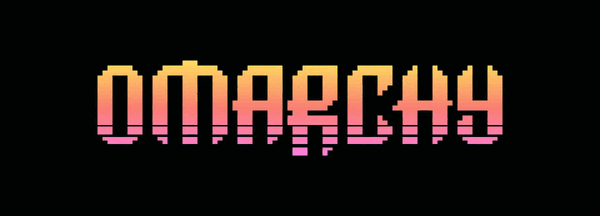
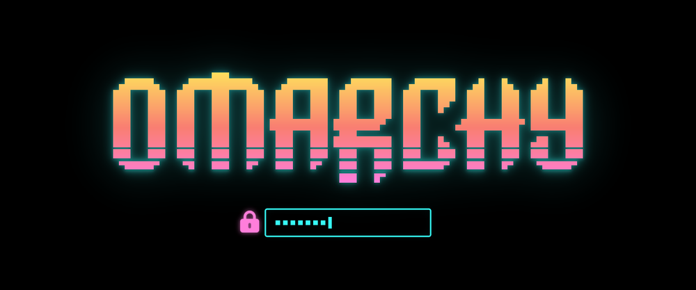
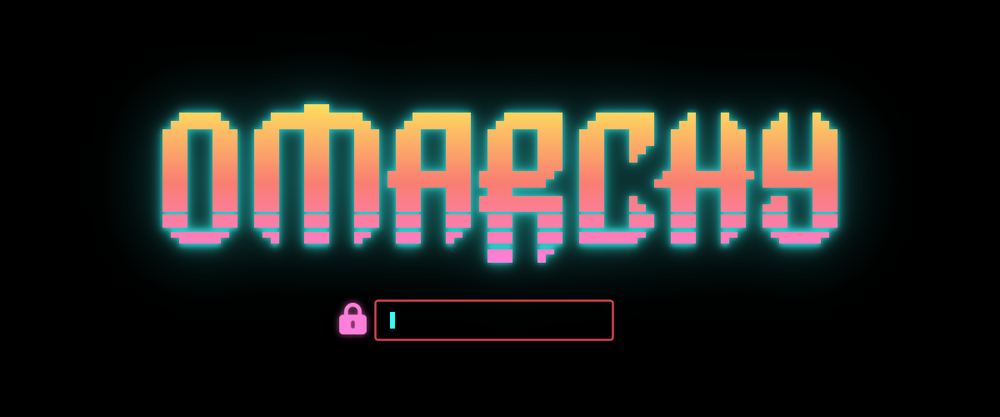
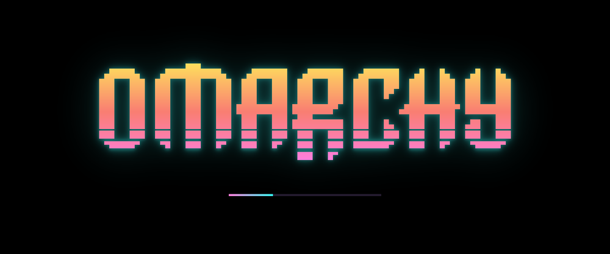
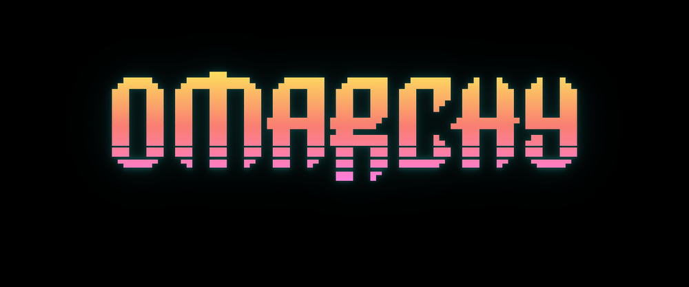
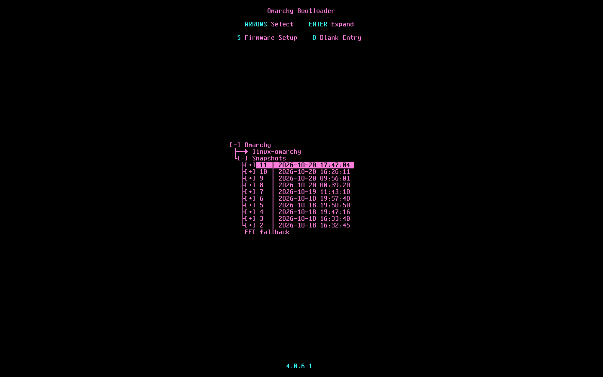

# Synthwave '84 OLED

An Omarchy theme: Synthwave '84 colours on an OLED-black base, with a neon-sunrise
background, pink-to-cyan window borders, an optional neon glow for windows and Ghostty,
and an optional animated boot and unlock splash.



## Install

```bash
omarchy theme install https://github.com/jsandai/omarchy-synthwave-84-oled-theme.git
```

## Neon glow

The glow is a separate step: a magenta halo around windows (coloured Hyprland shadows)
and a neon text glow in Ghostty (`neon-glow.glsl`), where coloured text spreads a soft
halo while black and white stay crisp. The text glow only runs on the terminal, so video
and photos elsewhere are untouched.

Omarchy won't load Lua or terminal configs from a theme installed from a git repo, so
the installer adds them to your own Hyprland and Ghostty config instead:

```bash
cd ~/.config/omarchy/themes/synthwave-84-oled/glow
./install.sh               # turn the glow on
./install.sh --uninstall   # turn it off again
```

It writes `~/.config/hypr/synthwave-84-oled-glow.lua` and appends a marked line to
`~/.config/hypr/hyprland.lua` and to your Ghostty config. Both only apply while this
theme is current, so switching themes turns the glow off without uninstalling. Re-run
`./install.sh` after a theme update to pick up changes to the window glow.

The pink-to-cyan window border needs none of this; it comes with the theme.

## Boot and unlock splash

Omarchy themes can only recolour Omarchy's stock splash. This theme does that too: pick
it in Omarchy's unlock-screen switcher, or run
`omarchy plymouth set-by-theme synthwave-84-oled`, and the splash gets the sunset logo
on black.

The full version is an animated Plymouth theme of its own, covering boot, the disk
unlock prompt, shutdown and reboot:

- the logo in a yellow-to-pink sunset gradient with a pulsing cyan glow
- a cyan password box with square bullets that flash white as you type, a block caret,
  and a red flash and shake on a wrong passphrase
- a pink-to-cyan progress bar after unlock, and the glow fading out on shutdown

| Unlock prompt | Wrong passphrase |
| --- | --- |
|  |  |
| **Booting** | **Shutdown** |
|  |  |

Captured from a real `plymouthd` (x11 renderer). On HiDPI panels it scales up with the
display.

It needs sudo and rebuilds your initramfs, so it is a separate step:

```bash
cd ~/.config/omarchy/themes/synthwave-84-oled/plymouth
./install.sh               # install and make it the default splash
./install.sh --uninstall   # back to Omarchy's splash
```

It installs to `/usr/share/plymouth/themes/synthwave-oled`, which no package owns, so
system updates leave it in place. Omarchy's own splash is not modified. Needs
`imagemagick` and `librsvg` to build the images.

## Boot menu

An optional Limine restyle to match: OLED black, a pink title and entries, cyan key
hints and a yellow countdown. The menu shows for 2 seconds, then boots the default entry.



```bash
cd ~/.config/omarchy/themes/synthwave-84-oled/limine
./install.sh               # restyle the menu (asks for sudo)
./install.sh --uninstall   # put the original settings back
```

Only the settings at the top of `limine.conf` change; the boot entries, which
`limine-entry-tool` and `limine-snapper-sync` regenerate, are left alone. The original
settings are saved next to the file and a full backup is made on every install. Quiet
mode is deliberately off: a quiet Limine draws nothing, so the firmware's logo stays on
screen and shows again after the disk unlock.

## pi

`pi.json` is a hand-tuned pi theme. `omarchy-theme-set` copies it to
`~/.pi/agent/themes/omarchy-system.json` on every theme switch when `~/.pi/agent`
exists, so pi follows the desktop with no extra setup.

pi validates custom themes against its schema on startup and rejects the whole
theme on any unknown key under `colors`, so the theme carries only stock keys.
The neon orange tool-panel outline and cyan spinner for
[pi-tool-frame](https://github.com/jsandai/pi-tool-frame) are set as hex values
in its config (`~/.pi/agent/extensions/pi-tool-display/config.json`):

```json
{
  "toolPanelStyle": "outline",
  "diffPanelBorderColor": "#ff8a3d",
  "diffRowBackground": "transparent",
  "workingIndicatorColor": "#03edf9"
}
```
